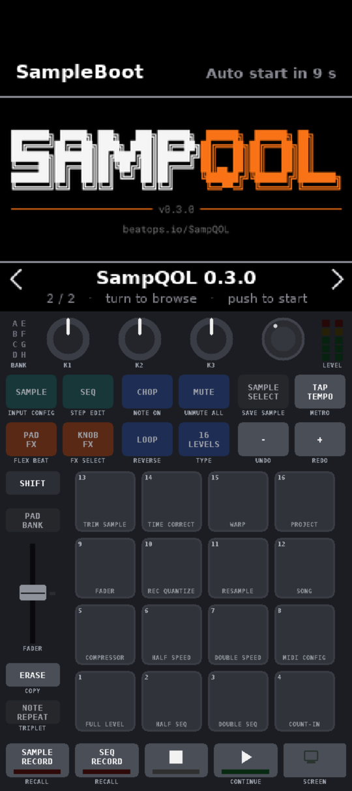
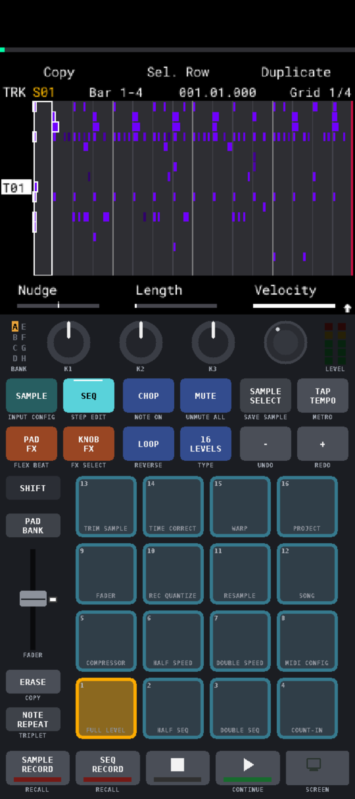

# MPC Sample Emulator for Pixel/Android

This kit runs Akai's official **MPC Sample 1.3.0** firmware, unmodified, in the Linux Terminal of a Pixel/Android phone.
It behaves like the hardware:

- **The microSD card** is a folder on your phone.
- **The card's `autorun`** boots at power-on, as on the real unit (SampleBoot, SampQOL and other mods).
- **The controls** are the same as on the hardware: pads, knobs, encoder, fader and buttons on a touch panel under the
  screen.
- **Sound** plays on the phone, and recording uses the phone's microphone.

Use it to play the MPC Sample on your phone, or to test mods and custom OSes before you install them on a real unit.

<p align="center">
  
  &nbsp;&nbsp;
  
  <br>
  <sub>Left: SampleBoot's boot menu, choosing SampQOL. Right: SampQOL's sequencer.</sub>
</p>

> **No Akai software is included.** You download the official updater from Akai yourself, and it is unpacked on your
> phone only. Don't share the `work/` folder the kit creates: it contains Akai's firmware.
> This project is not affiliated with or endorsed by Akai Professional or inMusic.

---

## Contents

1. [Requirements](#requirements)
2. [Installation](#installation)
3. [Starting and stopping](#starting-and-stopping)
4. [The microSD card](#the-microsd-card)
5. [Mods and alternative OSes (SampleBoot, SampQOL)](#mods-and-alternative-oses-sampleboot-sampqol)
6. [Commands](#commands)
7. [Options](#options)
8. [Updating](#updating)
9. [Moving to another phone](#moving-to-another-phone)
10. [Troubleshooting](#troubleshooting)
11. [Uninstalling](#uninstalling)
12. [How it works](#how-it-works)
13. [Files](#files)

---

## Requirements

| | |
|---|---|
| **Phone** | A phone whose Developer options include **Linux development environment** (the Android Linux Terminal). Developed and tested on a Pixel 10a. |
| **Storage** | 8 GB or more for the Linux Terminal's disk. The firmware unpacks to about 3 GB. |
| **Internet** | Needed once, during installation, to install Linux tools. |
| **Firmware** | Akai's official **MPC Sample 1.3.0 updater** (`MPC Sample 1.3.0 Updater.exe`, about 168 MB), from [akaipro.com](https://www.akaipro.com). |
| **Optional** | Mod zips to test, such as **SampleBoot** (a boot menu) and **SampQOL** (an alternative OS). Download them from their authors' official pages. |

> **Note:** other Android phones that run the Linux Terminal app (ARM64) should be able to run the emulator too, but
> they haven't been tested yet. If you try one, please open an issue and say how it went.

---

## Installation

### Step 1: Turn on the Linux Terminal (once per phone)

1. Open **Settings > About phone** and tap **Build number** 7 times, until "You are now a developer" appears.
2. Open **Settings > System > Developer options** and turn on **Linux development environment**.
3. Open the new **Terminal** app and let it download and install Debian (a few minutes).
4. In the Terminal app, open its **settings**, then **Disk resize**, and set it to **8 GB or more**.

### Step 2: Put the files in the MPC-Sample folder

1. Open the **Files** app, go to **Internal storage** (the top level, not Download) and create a folder called
   **`MPC-Sample`**. This folder becomes the emulator's **microSD card**.
2. Put **Akai's MPC Sample 1.3.0 updater** (`.exe`) in **Internal storage/MPC-Sample**.
3. Optional: put **mod zips** in the same folder, for example `SampleBoot-1.0.2.zip` and `SampQOL-OS-v0.3.0.zip`.
   The installer sets the card up from them. Leave the zips as downloaded; don't unzip them.

The Terminal sees this folder as **`/mnt/shared/MPC-Sample`**. It should look like this:

```
Internal storage/
└── MPC-Sample/
    ├── MPC Sample 1.3.0 Updater.exe
    ├── SampleBoot-1.0.2.zip        (optional)
    └── SampQOL-OS-v0.3.0.zip       (optional)
```

### Step 3: Install

Open the **Terminal** app and paste **one** of these commands.

**Option A: straight from GitHub (recommended).**

```
sudo apt-get update && sudo apt-get install -y git && git clone https://github.com/Phenix2417/mpc-sample-emulator ~/mpc-sample-emulator && cd ~/mpc-sample-emulator && ./mpc install
```

**Option B: from a kit zip.** Put the kit zip (`mpc-sample-emulator-v1.0.0.zip`, or a FULL zip) in the MPC-Sample
folder, then run:

```
command -v unzip >/dev/null || { sudo apt-get update; sudo apt-get install -y unzip; }; cd ~ && ls -tr /mnt/shared/mpc-sample-emulator*.zip /mnt/shared/*/mpc-sample-emulator*.zip 2>/dev/null | while read -r z; do unzip -oq "$z"; done; cd ~/mpc-sample-emulator && ./mpc install
```

The file names and version numbers of the zips don't matter: zips are recognised by what's inside them.
GitHub's green **Code > Download ZIP** button makes a different kind of zip; for that, use Option A instead.

`./mpc install` runs these steps (10–20 minutes the first time):

| Step | What happens |
|---|---|
| Pre-flight check | Checks the CPU, kit files, phone storage, `sudo`, free space, and finds the updater. Nothing is installed if a check fails; the message says how to fix it. |
| 1/5 Tools | Installs every Linux tool the kit needs: compiler, unpackers, bindfs, inotify-tools, ALSA headers… It installs only what's missing. |
| 2/5 Firmware | Unpacks the firmware from the updater into `~/mpc-sample-emulator/work/rootfs` and checks that it is version 1.3.0. |
| 3/5 Factory content | Puts the factory demo project in Internal > Projects > User > Factory Demo. |
| 4/5 The card | Sets up the card's `autorun` from the mod zips, if there are any. |
| 5/5 Start | Turns on autostart and starts the MPC. |

If the installer finds more than one possible updater, name the right one:
`./mpc install "/mnt/shared/MPC-Sample/MPC Sample 1.3.0 Updater.exe"`.

### Step 4: See the MPC

Tap the **display icon** in the Terminal app's toolbar to open the graphical display. The MPC screen is at the top,
with the control panel under it.

---

## Starting and stopping

- **Automatic:** after installation, the MPC **starts by itself whenever you open the Terminal app**. Tap the
  display icon to see it. Its log is `/tmp/mpc-run.log`.
- **By hand:** `cd ~/mpc-sample-emulator && ./mpc run`. Ctrl+C stops it.
- **Stop:** `~/mpc-sample-emulator/mpc stop`.
- **Turn autostart off or on:** `~/mpc-sample-emulator/mpc autostart off` or `… autostart on`.

At every start, new projects use the factory default template and the FADER controls pad volume. See
`MPC_KEEP_TEMPLATE` and `MPC_KEEP_FADER` under [Options](#options) to change this.

---

## The microSD card

The card is the phone folder **Internal storage/MPC-Sample**. It works like a real card:

- **Layout:** every folder in Internal storage/MPC-Sample is at the **card root**, e.g. `autorun/` and any folder you add.
  Loose files (zips, the updater) are left out.
- **Your saves:** the MPC keeps its projects and samples in an `MPC-Sample/` folder on the card, as the hardware
  does. They appear on the phone in **Internal storage/MPC-Sample/MPC-Sample/**.
- **Live in both directions:** what the MPC saves appears on the phone at once. A folder you copy into
  the MPC-Sample folder appears on the card within about 2 seconds.
- **Where to find it:** in the MPC's browser, the card is **SD CARD**. SAMPLE SELECT > B2 switches to External.
- **Safe:** the emulator never deletes files in your phone folder. All syncing copies.

To use a different folder as the card, run `MPC_EXTERNAL=<folder> ./mpc run`. `MPC_EXTERNAL=0` runs with no card.

---

## Mods and alternative OSes (SampleBoot, SampQOL)

The emulator boots exactly like the hardware. At power-on, the card's **`autorun/autorun.sh`** runs first. A mod
or boot menu can then stop the stock app and start something else. With no `autorun` on the card, the stock MPC
starts straight away. If an autorun doesn't take over within 15 seconds, the stock app starts.

### Set up the card from zips (easiest)

Put the zips in the MPC-Sample folder and run `./mpc card`. The installer also runs it.

| Zip | Becomes |
|---|---|
| **SampleBoot** | The card's `autorun`: a boot menu. **Turn the encoder** to choose an entry and **tap it** to start. |
| **Any other OS** (SampQOL, …) | A menu entry, `autorun/mods/SampQOL 0.3.0`. With no SampleBoot zip, a single OS becomes the card's `autorun`. |

**Newer versions:**

- **SampleBoot** is updated in place, and its settings and menu entries are kept.
- **A newer OS** is added as a new entry. The old entry is renamed `_SampQOL 0.3.0`, which hides it from the menu
  without deleting it.
- **Older zips** never replace newer versions, and nothing on the card is deleted.

### Set up the card by hand

- **One OS:** copy its `autorun` folder to **Internal storage/MPC-Sample/autorun**.
- **Several OSes with a menu:** use SampleBoot as `autorun`, and put each OS's `autorun` folder, renamed, in
  `autorun/mods/`, e.g. `autorun/mods/SampQOL 0.3.0/`.

### What is emulated for mods

- **Programs:** mods' programs, both dynamically linked and static (like SampleBoot's menu).
- **Screen:** `/dev/fb0`, and the display device (DRM) with the MPC's 320×240 panel mode, for apps that drive the panel
  themselves (like Melodee).
- **Control surface:** its MIDI on card 8, including the encoder and pads.
- **Start and stop:** `systemctl start/stop ac50` for the stock app, `systemd-run`, and service units an app writes to
  `/run/systemd/system` (Melodee's `sample-base.service`).
- **Card in `/proc/mounts`:** shown as `/dev/mmcblk1p1` under `/media/`.

Hardware extras the phone doesn't have are skipped: the 16-output USB audio gadget and raw SD card access.

Some mods check the firmware themselves. Melodee, for example, starts only on the MPC Sample program of firmware
1.3.0.12 exactly (it compares the program's checksum); with another updater it leaves the stock app running, as it
would on the hardware.

**Logs:**

- `work/run/script-runner.log`: the autorun's output.
- `work/run/mpc-*.log` and other `.log` files there: what mods started in the background (`systemd-run`, service
  units) printed, and logs mods keep in `/run` (Melodee's `melodee-sd.log`).
- `work/run/app.log`: the stock app.
- `autorun/sampleboot/last-boot.log`: written by SampleBoot itself.

---

## Commands

Run these in `~/mpc-sample-emulator`:

| Command | What it does |
|---|---|
| `./mpc install [updater]` | One-step install (see above). Safe to run again. |
| `./mpc run [seconds]` | Start the MPC, until Ctrl+C or for that many seconds. |
| `./mpc stop` | Stop it. The card is released safely. |
| `./mpc update` | Install the newest kit zip from the phone storage, then start the MPC. |
| `./mpc autostart on` / `off` | Start the MPC whenever the Terminal opens, or don't. With no argument it shows which. |
| `./mpc card [folder…]` | Set up the card's `autorun` from SampleBoot / OS zips. |
| `./mpc bundle [updater]` | Make the private FULL zip for another phone. |
| `./mpc content [folder or zip]` | Factory demo, or your own factory content, into Internal. |
| `./mpc reset` | MPC settings back to factory. The old ones are moved to `~/mpc-reset-backup-…`, not deleted. |
| `./mpc setup` | Install or check the Linux tools only. |
| `./mpc extract <updater>` | Unpack the firmware only. |
| `./mpc fix-sudo` | Fix `sudo: unable to allocate pty`. |

---

## Options

Options go before the command, e.g. `PANEL=0 ./mpc run`:

| Option | Effect |
|---|---|
| `MPC_BOOT=off` | Start the stock app directly, without the card's autorun. |
| `MPC_BOOT_GRACE=<seconds>` | Time the autorun gets to take over before the stock app starts (default 15). |
| `MPC_EXTERNAL=<folder>` | Another folder as the microSD card. `0` means no card. |
| `MPC_KEEP_TEMPLATE=1` | Keep your SAVE AS TEMPLATE template. |
| `MPC_KEEP_FADER=1` | Keep your FADER choice (SHIFT + PAD 9). |
| `PANEL=0` | No on-screen control panel. |
| `AUDIO_BRIDGE=0` | Sound straight to the phone, with no microphone. |
| `MIC_GAIN=<n>` | Microphone boost: 2 is +6 dB, 4 is +12 dB. |
| `AUDIO_PERIOD=<n>` | Smallest sound block (default 512). |
| `AUDIO16=0` | Turn off the 16-bit sound conversion. |
| `MPC_LOG=1` | Log all control MIDI to `work/run/`. |
| `MPC_SHARED=<folder>` | Look for the updater and zips somewhere other than `/mnt/shared`. |

**Microphone:** press **SAMPLE RECORD**. While it is lit, the phone's mic is the MPC's input and the MPC's sound is
muted. The phone can't play and record at the same time.

---

## Updating

- **Git install:** `cd ~/mpc-sample-emulator && ./mpc stop && git pull && ./mpc setup && ./mpc run`
- **Zip install:** put the new kit zip in the MPC-Sample folder, then run `~/mpc-sample-emulator/mpc update`.

Your firmware, settings and card are kept.

**Coming from the old `mpc-pixel-kit` folder?** Install the new kit with Option A or B above. The first `./mpc` command
moves the unpacked firmware from `~/mpc-pixel-kit` to `~/mpc-sample-emulator`, so nothing is unpacked again, and
`./mpc install` points autostart at the new folder. Then you can delete the old folder: `rm -rf ~/mpc-pixel-kit`.

---

## Moving to another phone

On a phone where everything works, run:

```
~/mpc-sample-emulator/mpc bundle
```

It writes **`MPC-Sample/mpc-sample-emulator-FULL-<version>.zip`** (in Internal storage), which contains:

- the kit;
- Akai's updater;
- your card's `autorun` (SampleBoot with its OSes) and the mod zips.

On the new phone, follow Step 1, put the FULL zip in Internal storage/MPC-Sample and run the **Option B** command. Nothing
else is downloaded. Your projects and samples aren't in the zip: copy the `MPC-Sample/MPC-Sample` folder across too if
you want them.

> **Keep the FULL zip to yourself.** It contains Akai's firmware and third-party mods, which may be used on your own
> devices but not shared or uploaded.

---

## Troubleshooting

| Problem | Fix |
|---|---|
| `sudo: unable to allocate pty: No such device` | Run `~/mpc-sample-emulator/mpc autostart off`, close the Terminal app fully (swipe it away), reopen it, then run `~/mpc-sample-emulator/mpc fix-sudo`. |
| `No Akai MPC Sample updater found` | Put the official 1.3.0 updater in Internal storage/MPC-Sample, or name it: `./mpc install "<path>"`. |
| `Free space: only … MB` | Terminal settings > Disk resize: 8 GB or more. |
| `Still missing: …` while installing tools | Check the internet connection and run `./mpc setup` again. |
| Nothing on screen | Tap the Terminal's **display icon**. Check `/tmp/mpc-run.log` (autostart) or the run's output. |
| The MPC doesn't start, or stops | See `~/mpc-sample-emulator/work/run/app.log` and `work/run/fbshim.log`. |
| A mod doesn't boot | See `work/run/script-runner.log` and the mod's own log on the card. `MPC_BOOT=off ./mpc run` starts the stock app without it. |
| The Save page says "No SD card" | Make sure Internal storage/MPC-Sample exists and contains at least one folder, then restart: `./mpc stop && ./mpc run`. |
| "Disk Too Slow!" | Streaming large samples from the phone folder can be slow. Use a card folder in the Linux storage: `MPC_EXTERNAL=$HOME/mpc-sd ./mpc run`. |
| Settings are in a bad state | `./mpc reset` moves them aside. Nothing is deleted. |

---

## Uninstalling

Stop the MPC first, so your phone folder isn't mapped into the kit while you delete it:

```
~/mpc-sample-emulator/mpc stop && ~/mpc-sample-emulator/mpc autostart off
grep -q mpc-sample-emulator /proc/self/mountinfo && echo "Still mounted - close and reopen the Terminal first" || rm -rf ~/mpc-sample-emulator
```

Your card (Internal storage/MPC-Sample) and its projects stay on the phone.

---

## How it works

- **Firmware:** the updater is unpacked (Akai's AZ0x container, or U-Boot FIT for other inMusic devices) into a
  folder. The program runs there in a `chroot`, with the device-tree identity of an MPC Sample.
- **The add-on** (`addon.c`) is preloaded into every program in that system. It provides:
  - the display (`/dev/fb0` and the DRM output), drawn with the touch control panel;
  - the internal control chip, as MIDI cards 8 and 9 and a sequencer;
  - 16-bit sound conversion and plugged-in jacks;
  - the SD card's FAT file-system type.
- **The card** is its own file system, named `/dev/mmcblk1p1` as on the hardware. Your phone folders are mapped onto
  it, and live watchers copy new content in both directions.
- **Booting:** a `systemctl` stand-in makes `ac50.service` the MPC app, and the card's `autorun.sh` runs first,
  exactly as the firmware's script runner would.
- **Static programs**, like SampleBoot's menu, get the screen and controls through `devrelay`.
- **Sound** goes through `audiobridge`, which plays it on the phone and switches to the microphone while SAMPLE
  RECORD is lit.

## Files

| File | What it is |
|---|---|
| `mpc` | Every command: install, setup, firmware extract, run, card, autostart, update, bundle. |
| `mpc.py` | Python helpers: the firmware containers, factory defaults, the control chip's other end, and the disk service that reports the card. |
| `addon.c` | The add-on preloaded into the MPC's system: display, control chip, sound, card and touch panel. |
| `helpers.c` | `audiobridge` (sound and microphone) and `devrelay` (devices for static mod programs), built from one file. |
